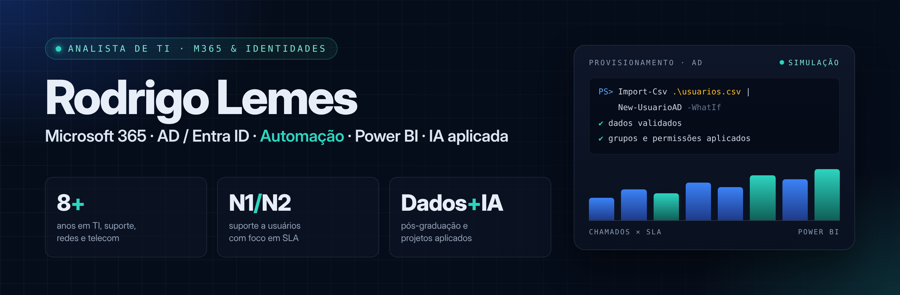

## Olá, eu sou o Rodrigo 👋

Profissional de **Tecnologia da Informação** com experiência em ambientes Microsoft, atuando com **Microsoft 365**, **Active Directory**, **Microsoft Entra ID**, **SharePoint** e **Teams**.

Perfil analítico e colaborativo, com facilidade para conectar áreas técnicas e de negócio, resolver problemas e apoiar usuários e processos de forma eficiente.

Hoje direciono minha carreira para **Dados, Inteligência Artificial e Power Platform**, transformando dados em soluções inteligentes que geram valor para o negócio.

> 🔎 **Aberto a oportunidades** como Analista de Suporte / Analista de TI.

## O que eu faço

| | Área | Na prática |
| :---: | --- | --- |
| ☁️ | **Microsoft 365** | Administração e suporte a Teams, SharePoint Online e ambientes colaborativos |
| 🔐 | **Identidades (AD / Entra ID)** | Gestão de usuários, grupos e permissões, com provisionamento padronizado |
| 🛠️ | **Suporte N1/N2** | Atendimento remoto e presencial via ITSM, com cumprimento de SLA |
| ⚙️ | **Automação** | Scripts em PowerShell e fluxos no Power Automate que eliminam tarefas manuais |
| 📊 | **Dados e BI** | Dashboards e indicadores operacionais em Power BI e Excel |
| 🤖 | **IA aplicada** | Desenvolvimento assistido por IA para acelerar rotinas e entregas |
| 🌐 | **Redes e telecom** | Monitoramento NOC/COP, tratamento de incidentes e diagnóstico de rede |

## Ferramentas

## Projetos em destaque

| Projeto | O que é | Stack |
| --- | --- | --- |
| [**AD Manager**](https://github.com/rodrigoalemes/ad-manager-powershell) | Provisionamento em massa de usuários e contas de serviço no Active Directory a partir de CSV, com validações automáticas e modo de simulação | PowerShell · Active Directory |
| [**Consulta de Ativos de TI**](https://github.com/rodrigoalemes/consulta-ativos-ti) | Consulta rápida ao histórico de equipamentos corporativos (bases Lenovo/Dell) por colaborador, apoiando o ciclo de vida dos ativos | Bases Lenovo/Dell |
| [**Automação Inteligente para Compras**](https://github.com/rodrigoalemes/automacao-inteligente-compras) | Solução com IA para análise e tratamento de solicitações de compra: processamento de documentos, consultas e relatórios | IA generativa · Automação |
| [**Dashboard de Indicadores**](https://github.com/rodrigoalemes/dashboard-indicadores-operacionais) | Painel interativo com consolidação e tratamento de bases para indicadores e apoio à decisão | HTML · CSS · JavaScript · IA |
| [**Comunicações Automatizadas**](https://github.com/rodrigoalemes/power-automate-comunicacoes) | Fluxo que lê uma base em Excel e envia e-mails personalizados com anexos em larga escala | Power Automate · Excel |
| [**Certificados SSL/TLS**](https://github.com/rodrigoalemes/ICPEdu-SSL) | Guia prático: gerar CSR com OpenSSL, instalar (Apache, Nginx, IIS) e validar | OpenSSL · Apache · Nginx · IIS |

## Trajetória

- 💼 **Analista de TI — Suporte e Operações** · Almaviva Solutions *(2023 – 2026)*
- 📡 **Analista COP Rede I** · Claro Brasil *(2021 – 2023)*
- 🔧 **Técnico Instalador Sênior** · ND Telecom *(2019 – 2021)*
- 🛰️ **Técnico de Manutenção de Equipamentos de Comunicação** · DESKTOP *(2018 – 2019)*
- 🖥️ **Analista de Suporte Júnior** · Indra Brasil *(2018)*

## Formação e trilha de estudos

- 🎓 Pós-graduação em **Ciência de Dados e Inteligência Artificial** — UNINTER *(2024)*
- 🎓 Tecnólogo em **Gestão da Tecnologia da Informação** — UniCesumar *(2022 – 2024)*
- 🎓 Técnico em Informática (hardware e redes) — People Computação *(2011 – 2013)*
- 📜 Formação BI — Módulo Avançado (Etek) · Excel Pro (Comunidade Data Driven) · Fundamentos de IA · Introdução à análise de dados (Microsoft Learn) · Introdução à IA e Prompts com a Microsoft (DIO)
- 🧪 No GitHub: [Contribuindo em um projeto open source (DIO)](https://github.com/rodrigoalemes/dio-lab-open-source)

## Contato

📍 Campinas, SP · Brasil
